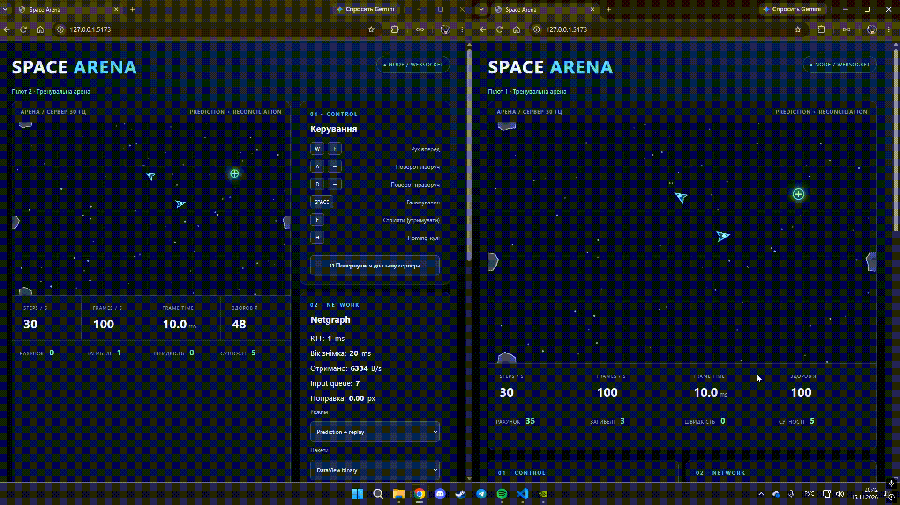

## Запуск і перевірка

У корені проєкту:

```powershell
npm.cmd install
npm.cmd run dev
```
Потім відкрити з консолі посилання на саму гру в браузері.

## JSON проти Binary

Результати вимірювання через `npm.cmd run measure:protocol`: тестовий стан з 2 кораблями, 5 астероїдами, 2 аптечками й 2 ack. Це байти payload, без накладних витрат WebSocket.

Пакет - JSON - Binary
Input - 107 Б - 8 Б
Snapshot - 1853 Б - 350 Б


## Мережа: затримка та звірка

Клієнт передає серверу лише input, а не координати, щоб гравець не міг просто змінити своє положення. Сервер обчислює стан гри на частоті 30 Гц.
Для швидкого реагування використовується prediction. Після отримання snapshot клієнт звіряє стан із сервером, повторно виконує непідтверджені input та згладжує поправку приблизно за 100 мс. Якщо фізика клієнта й сервера відрізняється, поправки збільшуються.
Для чужих кораблів обрано затримку інтерполяції 100 мс, щоб рух виглядав плавніше. Серверна симуляція захищає від підміни координат, але не усуває всі чіти, наприклад автоприцілювання.

## GIF двох вікон



