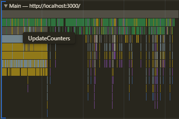
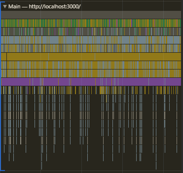

## Запуск і перевірка

```powershell
npm.cmd install
npm.cmd run typecheck
npm.cmd run lint
npm.cmd test
npm.cmd run build
npm.cmd run dev
```

## Порівняння продуктивності

Вимірювання протягом 30 секунд із 8 ботами.

Показник - До (Lab 06) - Після (Lab 07)

p50 кадру, мс 11,5 — 10,0  
p95 кадру, мс 17,8 — 10,1 
p99 кадру, мс 24,6 — 10,2 
Найдовша пауза GC, мс 8,5 — 2,1 
Найбільше об'єктів створює Вектори, кулі, частинки — Тимчасові об'єкти рендеру 


## Flame Chart





## Навантаження сервера

| Кількість клієнтів | p99 кроку, мс | Понад 33 мс? |
| 8 | 1.7 | Ні |
| 32 | 6.5 | Ні |
| 64 | 15.3 | Ні |
| 128 | Не виміряно | — | ECONNRESET |

## Web Worker

Порівняння обчислень у головному потоці та Web Worker:

- Main thread: 14.8 мс.
- Web Worker: 28.0 мс.

Висновок: у проведеному тесті Web Worker виконав обчислення повільніше (28,0 мс проти 14,8 мс). Оскільки прискорення не підтверджено, Worker не залишено в основній логіці гри.