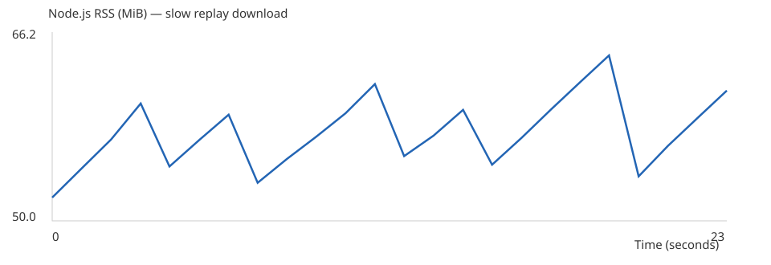

## Backpressure

 Якщо `write()` повернув `false`, запис очікує події `drain`. Для відтворення використовується `createReadStream` і `pipeline` до HTTP-відповіді, що враховує backpressure повільного отримувача.

### Графік RSS

Під час передавання NDJSON-файлу розміром 53,5 MiB використання пам'яті коливалося приблизно від 52 до 64 MiB без постійного зростання, що підтверджує ефективність потокового передавання.

## Цикл подій

- У браузері є DOM, Canvas, `requestAnimationFrame`. У Node.js замість DOM — `node:http`, потоки, файлові операції й доступ до оточення. У Node.js event loop працює через libuv: timers → pending callbacks → poll → check → close callbacks (із нюансами версій Node). Microtasks і `process.nextTick` обробляються між викликами JavaScript.
- Якщо HTTP-обробник синхронно заблокує потік **на 300 мс**, інші запити, ping/pong, таймери та повідомлення чату очікуватимуть: JavaScript обробник виконується на одному головному потоці. Тому файлове I/O й очікування слід робити асинхронно.
- `Room extends EventEmitter`: методи `join/leave` викликають `emit('joined'/'left')`. Особлива подія **`'error'`** без слухача у `EventEmitter` призводить до винятку, який може завершити процес Node.js. У класі Room додано обробник `error`.
- Код використовує **ESM** (`import/export`, `"type":"module"`). У **CommonJS** застосовують `require()` і `module.exports`. `npm workspaces` об'єднує client/server, але їхні runtime-середовища залишаються різними.
- Налаштування читаються з оточення: `PORT` у діапазоні 1–65535, `LOGS_DIR` — шлях до логів, `CLIENT_DIR` — каталог build. На SIGINT/SIGTERM сервер припиняє heartbeat, закриває сокети, HTTP-сервер, очікує `pipeline` й завершується з кодом **0**, якщо помилок немає.
