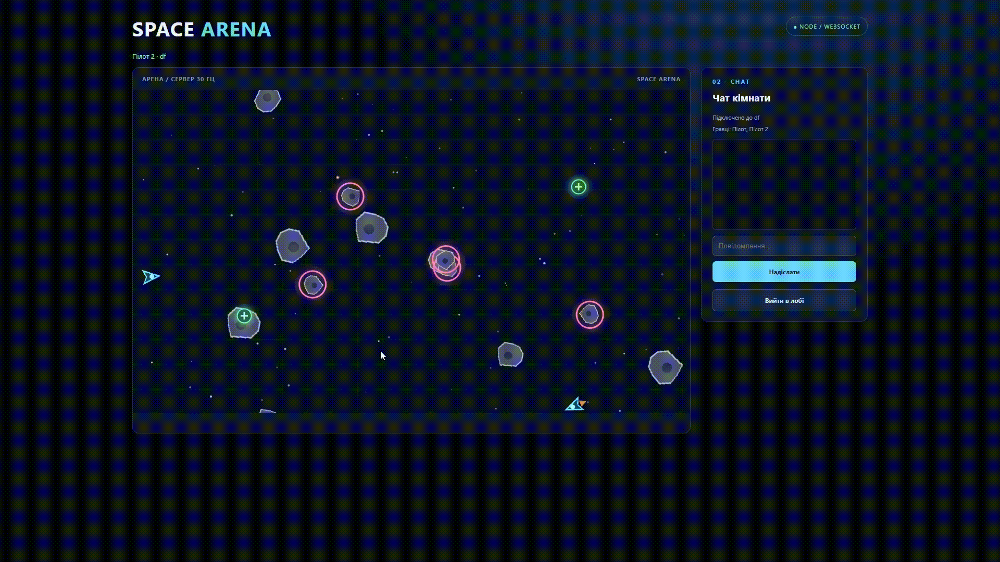

# Space Arena — Lab 08

[](https://github.com/MonJokery/space-arena/actions)

(https://space-arena-z2v1.onrender.com)


## Запуск
```powershell
npm.cmd install
npm.cmd run typecheck
npm.cmd test
npm.cmd run build
npm.cmd run dev
```
Docker (у корені проєкту):
```powershell
docker build -t space-arena:v1.0.0 .
docker image inspect space-arena:v1.0.0 --format '{{.Size}}'
docker run --rm -p 3000:3000 -e ALLOWED_ORIGINS=http://localhost:3000 --name space-arena space-arena:v1.0.0
```

## Архітектура

```text
Браузер (PWA/Canvas) ── HTTPS + WSS ── Proxy/TLS ── Node.js (один процес)
                                     ├─ RoomStore / WS / input
                                     ├─ shared/ симуляція 30 Гц
                                     ├─ NDJSON match replay + JSON pino logs
                                     └─ /health, /ready, /metrics
```

## Результати попередніх лабораторних

| Формат | JSON | Binary |
| Input | 107 Б | 8 Б |
| Snapshot (приклад) | 1853 Б | 350 Б |

| Кадр Lab 07 | Значення |
| p50 | 10,0 мс |
| p95 | 10,1 мс |
| p99 | 10,2 мс |
| Максимальний кадр | 10,4 мс |
| Довгих кадрів | 0 за 30 с |
| p95 рендеру | 0,5 мс |

Тест Lab 07: 30 секунд, 3001 вимірювання. У експерименті Worker: головний потік — 14,8 мс, Worker — 28,0 мс; прискорення не підтверджено. Це локальні результати, а не показники публічного сервера. Показники GC та Lab 06 не виміряні достовірно, тому не вказуються як фактичні.

## Демонстрація



**Відео 3–5 хв:** _вставити посилання після запису_.

| Перевірка з різних мереж | RTT |
| Гравець 1 | 2 мс |
| Гравець 2 | 25 мс |